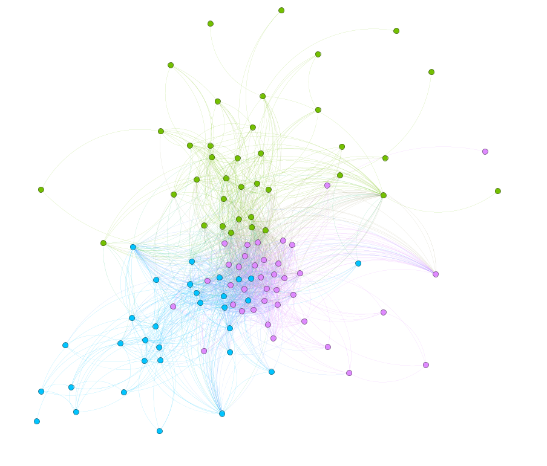

# NeuroData Network Research

**Exploratory functional association networks from extracellular neuronal spike trains**

This repository provides a reproducible Python workflow for inspecting an NWB electrophysiology recording, selecting quality-labeled neuronal units, summarizing firing activity, and constructing an undirected weighted network from correlations between binned spike counts.

> **Interpretation:** An edge represents a statistical association between two binned spike-count series. It does **not** establish a direct synaptic connection, anatomical connectivity, or causation.

## Network visualization



*Exploratory visualization exported from Gephi. Visual grouping and colors should not be interpreted as validated biological cell classes or anatomical pathways.*

## Dataset

- **Input format:** Neurodata Without Borders (NWB), processed electrophysiology and behavior.
- **NWB identifier:** `15a9c6eb-d2ac-4d49-ac7b-936c1fe3cb39`.
- **Session start:** `2020-01-16T15:53:21.500926-05:00`.
- **Recorded units:** 519, including 113 labeled `good` and 406 labeled `mua` in `units/kilosort2_label`.
- **Behavioral trials:** 854 entries in `intervals/trials`.
- **Data source and citation:** **To be verified.** The NWB identifier above is not a DANDI dataset identifier. Please add the official dataset URL, version, authors, and license before citing or redistributing derived data.

The raw NWB recording is not included in this repository. Place an authorized copy matching `*processed_behavior+ecephys.nwb` in `data/` to reproduce the analysis. The scripts expect exactly one matching file.

## Workflow

1. `inspect_nwb.py` — inspect top-level NWB groups and key datasets.
2. `inspect_experiment.py` — inspect neuronal units, behavioral trials, and recorded spike-time range.
3. `analyze_neurons.py` — summarize quality labels and firing rates; export per-unit CSV tables.
4. `build_neural_network.py` — bin spike trains, calculate pairwise Pearson correlations, construct a weighted graph, and export graph files.

## Methods at a glance

- Select units whose `kilosort2_label` is `good`.
- Count spikes in **1-second non-overlapping bins** beginning at time zero and ending at the final selected spike (rounded up to a complete bin).
- Remove units with constant binned spike-count series before correlation, if present.
- Compute Pearson correlations across binned spike-count series.
- Add an undirected edge when **`abs(r) >= 0.30`**. Store `correlation=r` and `weight=abs(r)`.

The correlation threshold is an exploratory modeling choice, not a biological significance threshold. See [Methodology](docs/methodology.md) and [Limitations](docs/limitations.md).

## Observed results

The following values were observed from a successful local execution of the workflow on the NWB recording described above:

| Measure | Value |
|---|---:|
| Recorded units | 519 |
| Units labeled `good` | 113 |
| Behavioral trials | 854 |
| 1-second time bins | 5,418 |
| Graph nodes | 113 |
| Graph edges | 1,621 |
| Graph density | 0.256163084703 |
| Connected components | 8 |
| Nodes in largest connected component | 106 |

These are descriptive results for **one recording and one parameter setting**. They should not be generalized across sessions or animals without additional analyses.

## Installation

Tested locally with **Python 3.14.0** and the pinned packages in `requirements.txt`.

```powershell
python -m venv .venv
.\.venv\Scripts\Activate.ps1
python -m pip install -r requirements.txt
```

Place the input NWB file in `data/`, then run:

```powershell
python .\inspect_nwb.py
python .\inspect_experiment.py
python .\analyze_neurons.py
python .\build_neural_network.py
```

## Outputs

| File | Description |
|---|---|
| `results/neurons_all.csv` | Per-unit summary for all recorded units |
| `results/neurons_good.csv` | Per-unit summary for units labeled `good` |
| `results/neural_edges.csv` | Pairwise associations passing the threshold |
| `results/neural_network.gexf` | Network exchange format for Gephi and other tools |
| `results/neural_network.graphml` | GraphML network export |
| `results/correlation_matrix.npy` | Intermediate correlation matrix; ignored by Git |
| `results/figures/neural_network_communities.png` | Gephi visualization |

The raw dataset, local environments, and large intermediate files are excluded through `.gitignore`.

## Reproducibility and responsible interpretation

See [Methodology](docs/methodology.md) for implementation details and [Limitations](docs/limitations.md) for analytical caveats. In particular, raw correlations may reflect common drive, temporal trends, firing-rate differences, or behavioral state rather than direct neuronal interactions.

## Data provenance and licensing

**Pending verification:** Confirm the original public dataset record, preferred citation, and data-use terms before publishing derived CSV, graph, or figure outputs. No license is asserted for the original NWB recording or derived scientific data in this README.
